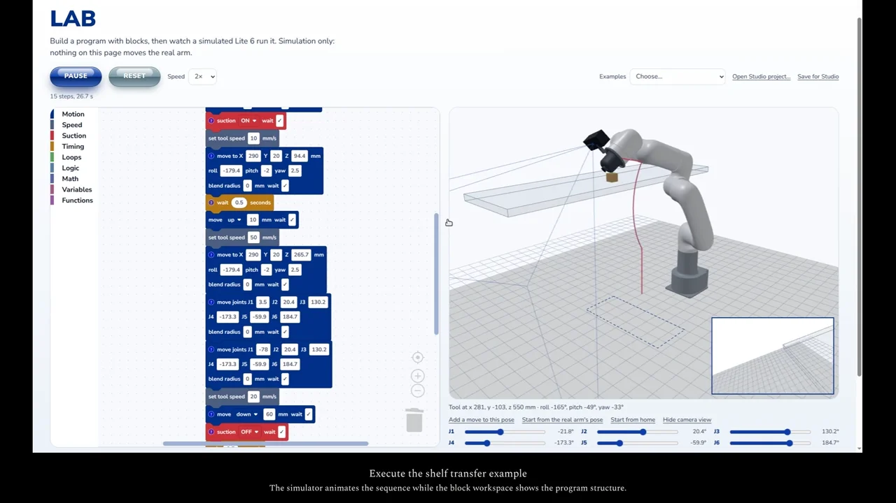

# Lite6 Lab Deck

A local vision and robotics workspace for the UFACTORY Lite6 and Luxonis OAK-D Pro PoE. The browser interface combines camera inspection, guided robot demonstrations, a block-programming simulator, and classroom documentation. This project is separate from the JetMax controller.

[](https://trylen22.github.io/demos/lite6/)

[Watch the captioned demonstration](https://trylen22.github.io/demos/lite6/). The page also provides the MP4 and subtitle file.

The recording shows the **Lab simulator only**. It does not operate the physical arm. Hardware trials and their limits are documented separately in [current status](docs/STATUS.md) and [session history](docs/SESSION_LOG.md).

## Joining the project

- [Lab network and device addresses](docs/LAB_SETUP.md): the shared Lite6 is `192.168.1.152`; the OAK camera is `169.254.1.222`. The host needs access to both subnets.
- [Mac camera setup](docs/MACOS_SETUP.md): platform-specific network and dependency diagnostics; Mac hardware validation is pending.
- [Coding-agent setup and first-session prompt](docs/AGENT_SETUP.md): Codex, Claude Code, software checks, and the local files a clone does not include.
- [Shared-station configuration example](config/lab.station.example.toml): known network addresses, with no taught motion data.

## Capabilities

| Area | Implementation |
|---|---|
| Color inspection | OpenCV HSV masks, contours, annotated images, and adjustable region thresholds |
| Object detection | YOLOX-Nano through OpenCV DNN on the host CPU; 80 COCO classes |
| Robot observation | Controller state, faults, pose, joints, and freshness indicators through the UFACTORY SDK |
| Green pickup | Locally calibrated image alignment, bounded seal search, suction feedback, lift, release, and return to observation height |
| Shelf transfer | A separate taught route and release sequence using local waypoints |
| Hand following | Open-palm tracking with bounded wrist-joint servo motion; base, shoulder, elbow, and roll remain fixed |
| Lab | Blockly beside a three.js Lite6 model, simulated tool and wrist view, and Studio project import/export |

The pickup and hand demonstrations depend on local calibration, mounting, and workspace settings. They are not general scene understanding or collision avoidance. YOLO detections do not directly command the arm.

## Run locally

Validated baseline: Linux x86_64 with Python 3.12. The original Jetson Nano has not been validated with this dependency set.

```bash
git clone https://github.com/Trylen22/lite6-lab-control.git
cd lite6-lab-control
python3 -m venv .venv
.venv/bin/python -m pip install -r requirements-deck.txt
```

For a fresh-clone simulator preview without lab hardware, use the explicit observer configuration:

```bash
.venv/bin/python -m labdeck.server --config config/lab.simulator.example.toml
```

Open `http://127.0.0.1:8100/#lab` and select an example. The Lab page simulates programs; it never sends robot motion commands. Missing hardware is reported by the observation workers. For the shared physical station, create `local/lab.toml` from `config/lab.station.example.toml` and follow the two-subnet instructions in [Lab setup](docs/LAB_SETUP.md), then use `./run.sh` for the full camera workspace. For a different installation, use the blank `config/lab.example.toml`. The launcher reuses an existing producer on port 8090 and stops only processes it started.

**Hardware behavior:** selecting Color detection or Hand puppy can move the arm to its configured demo pose. Start following, Pick & Place, and Pick to Shelf are physical actions. Use the Lab URL for an offline programming demonstration.

Optional models are downloaded explicitly:

```bash
.venv/bin/python scripts/download_yolo.py
.venv/bin/python -m pip install -r requirements-hands.txt
.venv/bin/python scripts/download_hands.py
```

## Calibration and control

Color regions begin as image pixels. A measured local XY response and taught suction reference map image error to bounded movement within the calibrated tabletop domain. Suction is enabled before the final approach, and seal feedback gates lifting. A completed pickup releases the object and returns to observation height. Shelf transfer uses a separate taught path.

The hand display is rotated for the camera mounting; this display transform does not change sensor coordinates. Hand following uses wrist joints 4 and 5 in servo mode, with configured angle, speed, acceleration, and heartbeat limits. It does not extend the base toward a person. See the implementation and current status for the exact policy.

The Lab model uses UFACTORY meshes and an optional per-arm kinematic fit. Importing or running a Studio block program in Lab remains a simulation. Physical execution of arbitrary student programs is a separate feature.

## Read the project

| Resource | Purpose |
|---|---|
| [Classroom guide](docs/CLASSROOM_GUIDE.md) | Exercises and discussion questions |
| [Architecture](docs/ARCHITECTURE.md) | Processes, units, coordinate frames, and failure handling |
| [Calibration plan](docs/CALIBRATION_PLAN.md) | Mounting checks and measurement procedure |
| [Lab setup](docs/LAB_SETUP.md) | Network and hardware preparation |
| [Current status](docs/STATUS.md) | Recorded validation and remaining limits |
| [Session history](docs/SESSION_LOG.md) | Detailed development and trial history |
| [Third-party references](docs/THIRD_PARTY.md) | Models, meshes, libraries, and provenance |

Historical notes describe earlier experiments and speed limits; consult the current code and status before using a physical routine. Do not copy another station's contact poses, offsets, or calibration.

## Source map

- `assets/`: browser interface; `assets/lab/` contains the simulation.
- `labdeck/`: observation workers, color and hand policies, job dispatch, and guarded physical routines.
- `scripts/`: camera ownership, model downloads, setup inspection, and explicit calibration tools.
- `config/lab.example.toml`: sanitized configuration template.
- `tests/`: offline geometry, observation, policy, HTTP, and simulation checks.
- `local/`: ignored device settings, calibration, models, and traces.

## Checks

```bash
.venv/bin/python -m unittest discover -s tests -v
node --check assets/app.js
bash -n run.sh
```

The offline suite passed 98 tests during the documentation and demo update on 2026-10-26. This verifies software behavior under the tested fixtures; it does not establish physical readiness. The UI stop controls do not replace the physical emergency stop.
