# How the Lab Deck works

The application observes a camera and an arm through separate software boundaries. An explicit button request can dispatch one guarded pickup worker; observations alone never dispatch movement.

```mermaid
flowchart LR
    OAK[OAK camera] -->|Temporary CAM_A pipeline| Producer[Camera producer :8090]
    Producer -->|Fresh JPEG over loopback| Vision[Color or YOLO worker]
    Vision -->|Annotated image and candidates| Deck[Lab Deck :8100]
    Arm[Lite 6] -->|SDK getters| Observer[RobotObserver]
    Observer -->|Cached telemetry| Deck
    Deck --> Browser[Local browser]
    Browser -->|Host-only vision settings| Vision
    Browser -->|Explicit one-cycle POST| Jobs[Single-job dispatcher]
    Jobs --> Guard[CalibrationArm and pickup checks]
    Guard -->|Checked SDK motion and suction| Arm
```



## Why two processes?

The camera producer already worked before the new deck. Keeping it separate gives us one clear owner of the OAK device. The deck consumes its JPEGs instead of opening a competing camera connection. A student can inspect the raw producer independently at `http://127.0.0.1:8090/`.

The launcher can create the producer, or reuse an existing one. It records ownership through child process handles and only terminates processes it created. Nothing is configured as a boot service.

## A frame's journey

1. `camera_preview.py` opens the explicitly selected OAK address, identifies connected sensors, and requests CAM_A color at 640 × 400 and 15 FPS. This is a temporary pipeline, not a persistent firmware installation.
2. A queue of two frames avoids accumulating old work. The producer JPEG-encodes the latest image and tracks its arrival using a monotonic clock.
3. The deck asks `/snapshot.jpg` for a fresh image. The producer returns HTTP 503 if its image is older than three seconds. Proxy environment settings are ignored for this loopback connection.
4. The vision worker decodes the JPEG into OpenCV's **BGR** channel order. It runs the selected method on the host CPU.
5. A drawing function adds rectangles/centroids to a copy. The raw image remains available independently. The processed image and JSON measurements are published together under a lock.
6. Browsers consume MJPEG and poll `/api/status`. A mode-change revision prevents an older in-flight color result from being published under a newly selected YOLO mode.

Requested camera FPS and processed FPS are different. The deck intentionally processes at a modest rate, leaving headroom on the laptop. Its FPS metric describes received/processed observations, not sensor exposure timing.

## Color detection, explained

Read `labdeck/color.py`:

- Blur reduces tiny sensor/chroma fluctuations.
- BGR-to-HSV conversion separates hue, saturation, and brightness.
- Each preset selects a range of HSV values. Red needs two ranges around the circular hue boundary. The broad green/cyan range follows the JetMax project's color family.
- Morphological opening removes small speckles; closing fills small gaps.
- External contours describe connected regions.
- Area, aspect, fill, and solidity checks reject some tiny, narrow, or fragmented shapes.
- Moments estimate a candidate centroid. Bounding rectangles and areas are returned in pixels.

This is appearance matching. A large green distractor can pass the filter. We retained the useful JetMax teaching pattern and deliberately omitted its millimeter-per-pixel scale, arm offsets, and saved coordinates.

## YOLO detection, explained

Read `labdeck/yolo.py`:

- The official YOLOX-Nano ONNX model is loaded lazily, only when YOLO mode is requested. No model is downloaded by opening the page.
- The 416 × 416 input preserves aspect ratio and pads the bottom/right with 114. This release expects BGR values in the 0–255 range; applying a different model's normalization would be wrong.
- OpenCV DNN runs inference on the laptop CPU.
- Raw outputs encode offsets on grids with strides 8, 16, and 32. The decoder maps them into input-image box centers and sizes.
- Objectness multiplied by class probability produces a ranking score. It is not a calibrated guarantee that the prediction is true.
- Boxes are transformed back to source-image pixels and clipped to the frame. Non-maximum suppression removes overlapping duplicates within each class.

The decoder intentionally rejects incompatible export shapes. Replacing the ONNX file requires matching preprocessing, output decoding, class labels, and tests. On-camera YOLO is a possible later optimization with an appropriate Luxonis RVC2 conversion; it is not running in this phase.

## Robot SDK boundary

`RobotObserver` owns the SDK object. The HTTP handler never receives that object. The observer uses only:

```text
connect / disconnect
get_version
get_state
get_err_warn_code
get_position
get_servo_angle
```

The SDK performs its connection/version handshake. We disable optional report/timed-communication workers and poll our explicit getters about every three seconds. A nonzero getter return code means its value is not displayed as a successful measurement. Controller state is shown as a numeric code, without inventing an interpretation for undocumented states.

An SDK response describes controller information. It does not establish safe mounting, correct payload, an operational emergency stop, or readiness for movement. The separate pickup worker rechecks the session-specific controller and tool configuration before moving.

## Units and frames

| Value | Unit and frame |
|---|---|
| Detection box | `[left, top, width, height]`, image pixels |
| Color centroid | `[x, y]`, image pixels; origin top-left |
| Color area | Contour area in square pixels |
| YOLO score | Model ranking score from 0 to 1 |
| Robot X/Y/Z | Controller-reported tool position, millimeters |
| Roll/pitch/yaw | Controller-reported orientation, degrees |
| J1–J6 | Joint angles, degrees; SDK's extra placeholder is omitted in the UI |
| Age | Seconds since the local worker received a result, using a monotonic clock |

The pickup worker solves the measured 2x2 XY image response at fixed height and wrist orientation. The cup aim comes from a successful seal reference. This is limited to the taught tabletop/object-height region; it is not general camera extrinsic calibration.

## HTTP boundary and failures

| Endpoint | Behavior |
|---|---|
| `GET /` | Local classroom interface |
| `GET /api/status` | Cached vision and robot observations plus freshness |
| `GET /stream.mjpg?view=annotated` | Selected vision overlay |
| `GET /stream.mjpg?view=raw` | Original image from the producer |
| `GET /stream.mjpg?view=mask` | Threshold mask while in color mode |
| `POST /api/vision` | Validated host-only mode/preset/area/confidence settings |
| `POST /api/pick-place` | Empty JSON plus explicit action header; dispatch exactly one guarded cycle |

No arbitrary-coordinate, jog, enable, reset or standalone tool endpoint exists. Unknown actions return 404. Invalid settings return 400 and leave the active configuration intact. Cross-origin browser writes are rejected. Both servers bind to loopback; they are not authenticated services intended for public exposure.

The browser obscures stale video with a status overlay and clears old detections. Robot values are hidden after their freshness window. A worker error is shown without clearing robot faults, reconnecting the robot automatically, or retrying a physical action. The camera producer exits if no new frame arrives for 20 seconds. Restart is an operator action.

## Explicit pickup job

`jobs.py` owns one worker under a lock. A duplicate request returns 409. Starting
a page or server never starts a job. The worker snapshots the detection threshold
and loads ignored `local/automation.json`; the request cannot supply geometry.
Expiry, camera session, fixed height/orientation, checked bounds, fresh controller
reports, release state and configuration must pass. Fresh target acquisition needs
three distinct consecutive stable frames; missed detections reset that window.

`automatic_pick.py` checks IK continuity, applies bounded XY corrections and
compares observed image movement with the measured response. The final descent
is checked again. Suction output is verified before a bounded contact search;
independent stable attachment feedback gates lift. Release readback gates the
vertical return to observation height. Failure reports an error without an
automatic retry or blind recovery movement. Trial events also drive UI progress.

Cross-origin requests and missing action headers are rejected. These are local
services, not authenticated remote-control APIs. Normal shutdown waits for an
owned active cycle; browser closure and terminal closure are not emergency stops.

## Extending a local workspace

`workspace_preview.py` performs getter-only checks of the visible target's
candidate corridor on a 3×3 XY grid. `CalibrationArm.preview_path` carries IK
seeds across hypothetical segments, so descent is vertical at the destination
instead of a diagonal from the live starting pose. No SDK move is issued.
A grid pass demonstrates sampled kinematics, not obstacle clearance or every
interior configuration. Every executed segment still gets a fresh preview.

An optional union of `xy_regions_mm` keeps separate checked areas distinct;
transits are sampled at <=1 mm through the union. The outer rectangle alone
is not permission to cross the unaccepted space. Readiness now estimates the
target from the current cached centroid, while the worker re-acquires stable
frames and checks the predicted travel/descent/return before first movement.
